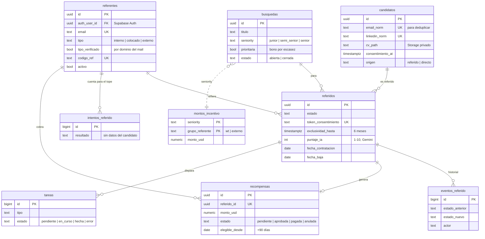
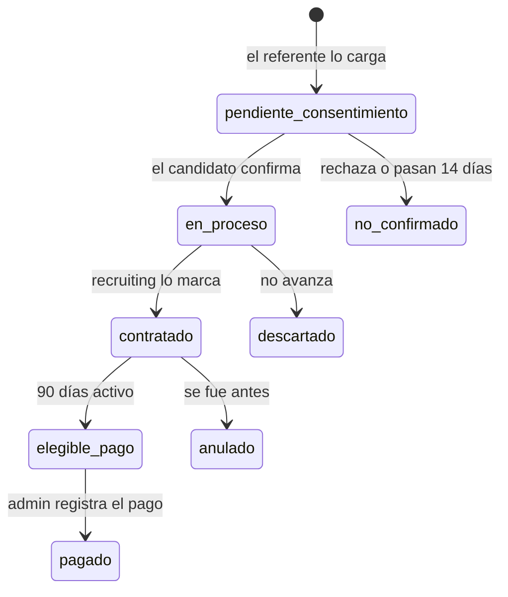

# Modelo de datos

Postgres en Supabase. Las reglas del programa viven en la base (`supabase/schema.sql`): la landing llama a funciones que validan e insertan todo en una sola transacción, y n8n procesa una cola de tareas. Así las reglas no se pueden saltear desde el navegador y dos cargas simultáneas no pueden romperlas.

## Diagrama

Tablas de soporte, fuera del diagrama: `config` (los números del negocio) y `staff_recruiting` (quién no puede referir).

## Estados de un referido

## Decisiones del modelo

| Decisión | Por qué |
|---|---|
| **Las reglas viven en funciones de la base**, no en la landing ni en n8n | No se pueden saltear desde el navegador, y validar e insertar ocurre en una sola transacción. n8n corre en local y Vercel no lo puede llamar |
| **Chequeo + índice único** para duplicados | El chequeo da el mensaje claro. El índice único (un solo referido activo por candidato) es la garantía si dos referentes cargan a la misma persona en el mismo instante |
| **Normalizar antes de comparar** mail, LinkedIn y teléfono | `Martin.Sosa@x.com ` y `martin.sosa@x.com` son la misma persona. El LinkedIn pierde protocolo, `www`, parámetros y la barra final. El teléfono se compara por los últimos 10 dígitos (ignora el +54 y el 9 de los celulares) |
| **`config` en vez de números en el código** | Si WorldTeams responde con otros valores (ventana, días, tope), se edita una fila |
| **Los montos se calculan al contratar y se recalculan al aprobar** | Si un admin verifica a un colocado durante los 90 días, cobra como gente de WorldTeams |
| **`intentos_referido` sin datos del candidato** | El tope cuenta también los rechazados, y un rechazo no deja guardados datos de un tercero |
| **Historial con un trigger** | Cada cambio de estado queda registrado, se haga desde la landing, desde n8n o a mano en Supabase |
| **Cola `tareas` (patrón outbox)** | La base anota "hay que mandar este mail" en la misma transacción del cambio. Si n8n está caído, nada se pierde: lo procesa cuando vuelve. Reintenta hasta 3 veces |
| **Un solo punto para "contratado"** (`marcar_contratado`) | Hoy lo llama recruiting a mano. Mañana, la herramienta de selección que usen |

## Seguridad (RLS)

- **Públicas:** búsquedas abiertas y tabla de montos (las muestra la landing).
- **Del dueño:** cada referente ve solo su perfil y sus recompensas. Sus referidos los ve por `mis_referidos()`, que no devuelve el puntaje de IA ni los datos de contacto del candidato.
- **Sin acceso con la clave pública:** candidatos, referidos, intentos, historial, tareas, configuración y lista de recruiting.
- **CV:** bucket privado; cada referente sube solo a su carpeta y n8n los lee con la clave secreta.
- Las funciones internas (cola de tareas, revisión diaria, contratación, pago) solo las ejecuta n8n o un admin.

## Funciones que usa la landing

| Función | Quién la llama | Qué hace |
|---|---|---|
| `info_programa()` | Cualquiera | Montos y reglas para la página de inicio (sin exponer `config`) |
| `crear_referido(...)` | Referente logueado | Aplica todas las reglas y registra el referido. Devuelve `{ok, motivo}` |
| `cupo_restante()` | Referente logueado | Cuántas cargas le quedan este mes |
| `mis_referidos()` | Referente logueado | Su panel: estado, recompensa real o estimada, hasta cuándo vale |
| `datos_consentimiento(token)`, `confirmar_consentimiento(token)`, `rechazar_consentimiento(token)` | El candidato, con el link del mail | Muestran y registran su respuesta. Devuelven `{ok, codigo}` |

Las funciones devuelven **códigos** y no textos: el idioma lo pone la landing.

## Cómo se prueba

`supabase/tests.sql` crea usuarios de prueba, ejercita 36 casos (registro, autorreferido, duplicados, tope, recruiting, consentimiento, recompensas, baja, ventana, panel y cola de tareas), borra lo que creó y muestra el resultado de cada caso. `supabase/chequeo.sql` verifica estructura, permisos y datos iniciales sin modificar nada. Los cambios sobre una base ya creada están en `supabase/migraciones/`.
