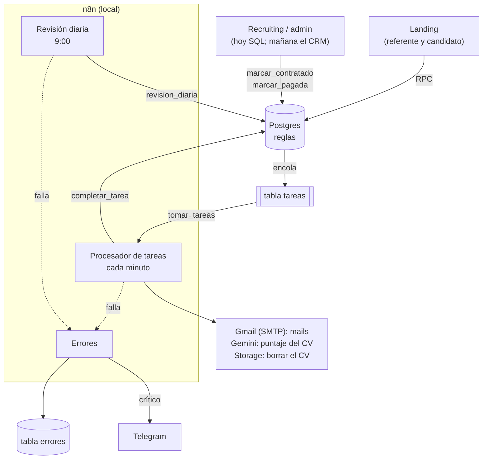
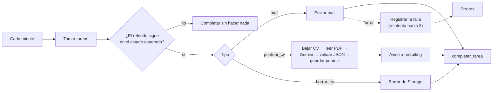

# Flujo de automatización

**La base decide, n8n ejecuta.** Cada regla (duplicados, tope, consentimiento, 90 días) vive en una función de Postgres. Cuando un cambio necesita una acción afuera de la base (mandar un mail, puntuar un CV, borrar un archivo), la misma transacción anota una **tarea** en la cola. n8n toma esa cola cada minuto y hace el trabajo.

¿Por qué así y no con webhooks? n8n corre en local y la landing está en Vercel, que no puede llamarlo. Con la cola (patrón *outbox*) no hace falta que se vean: si n8n está apagado, nada se pierde; lo procesa cuando vuelve.

## Diagrama general

## Los eventos, uno por uno

| Evento | Lo dispara | Qué decide la base | Qué hace n8n | Le llega a |
|---|---|---|---|---|
| **1. Alta de referido** | El referente, en `/refer` | `crear_referido` aplica todas las reglas y, si pasa, encola `mail_consentimiento` | Manda el mail con el link `/consent/<token>` y el plazo de 14 días | Candidato |
| **2. El candidato acepta** | El candidato, con el link | Pasa a "en proceso" y encola `puntuar_cv` | Baja el CV, Gemini lo puntúa contra la búsqueda, guarda el puntaje y avisa | Recruiting (con puntaje y justificación) |
| **3. Rechaza o vence** | El candidato ("No, thanks") o la revisión diaria (14 días sin respuesta) | Pasa a "no confirmado" y encola el aviso y el borrado del CV | Avisa al referente y borra el PDF | Referente |
| **4. Contratación** | Recruiting, con `marcar_contratado` | Si está dentro de la ventana de 6 meses, crea la recompensa pendiente a 90 días | Manda el monto y la fecha de pago | Referente |
| **5. Cumple los 90 días** | La revisión diaria | Sin baja y con el referente activo: aprueba. Si no: anula, con el motivo | Avisa al referente; si se aprobó, pide el pago con el comando para registrarlo | Referente y administración |
| **6. Pago** | Administración, con `marcar_pagada` | Cierra el circuito ("pagado") | — (el referente lo ve en su panel) | — |

## Los tres workflows

Son tres porque cada uno arranca por un motivo distinto. Juntos son un solo flujo.

| Workflow | Arranca | Qué hace | Fuente |
|---|---|---|---|
| **Procesador de tareas** | Cada minuto | Toma hasta 10 tareas y ejecuta cada una (mails, puntaje, borrado) | `n8n/build_tareas.py` |
| **Revisión diaria** | Todos los días a las 9:00 (Buenos Aires) | Llama a `revision_diaria()`: aplica las reglas de tiempo. Los avisos quedan en la cola | `n8n/build_revision.py` |
| **Errores** | Cuando otro workflow falla, o cuando el procesador reporta una tarea fallida | Registra la falla sin datos personales y, si es crítica, alerta por Telegram | `n8n/build_errores.py` (reutilizado del CV Screener) |

Los workflows se generan con scripts (`python3 build_*.py`) y no se editan a mano en n8n: así el código de los nodos se prueba fuera de n8n (`node test_js.js`, 25 casos) y el repo es la fuente de verdad.

### Adentro del procesador

## Cuando algo falla

| Qué pasa | Qué hace el sistema |
|---|---|
| n8n está apagado o sin conexión | Las tareas esperan en la cola y se procesan cuando vuelve |
| Falla una tarea (Gmail, Gemini) | Se reintenta en el minuto siguiente, hasta 3 intentos. Las fallas intermedias se registran sin alertar |
| Una tarea agota sus 3 intentos | Alerta crítica por Telegram: un error persistente llega a una persona |
| Un corte de conexión hace fallar al procesador cada minuto | Una sola alerta: la misma falla no se vuelve a avisar por 30 minutos (si sigue, llega un recordatorio). El registro sigue siendo uno por falla |
| n8n se corta a mitad de una tarea | La tarea queda "en curso" y se retoma a los 10 minutos. Costo: en ese caso raro, un mail puede salir dos veces |
| Una ejecución se cuelga | Se corta a los 5 minutos, antes de que se cruce con el reintento |
| La tarea ya no tiene sentido (el candidato confirmó y el mail de consentimiento seguía en la cola) | Se completa sin hacer nada |
| La IA no puede puntuar el CV | El aviso a recruiting sale igual, sin puntaje: el referido no se traba por la IA |

## Decisiones

| Decisión | Por qué |
|---|---|
| n8n no decide nada de negocio | Las reglas están en un solo lugar (la base) y no se pueden saltear. n8n solo ejecuta lo que la base anotó |
| El puntaje de la IA **prioriza, no decide** | Recruiting recibe el puntaje con su justificación y decide. En la prueba, un desarrollador backend referido para BIM Coordinator sacó 1/10 por "no tener experiencia en arquitectura, BIM ni Navisworks" |
| El CV es **dato, no instrucciones** | El prompt lo aclara y la respuesta del modelo pasa por un validador antes de guardarse: defensa básica contra *prompt injection* |
| Sin datos personales en los registros de error | Los mails que aparecen en un mensaje de error se tapan (`[email]`) |
| Los nombres se escapan antes de entrar al HTML de los mails | Los escribe un tercero (el referente) |
| Mails en inglés; internos a alias de Gmail | El programa es para LATAM con clientes en EE. UU. En producción, los mails internos van a las casillas de cada equipo (un solo nodo de configuración) |

## Cómo se probó

De punta a punta, en la landing publicada y con n8n corriendo: referir, aceptar, puntuar, contratar y aprobar la recompensa, más un corte de conexión real y una alerta de error (casos N8N-01 a N8N-07 de `PRUEBAS.md`). Las reglas de la base las cubre `supabase/tests.sql` (41 casos).

## Segunda etapa

- Integración con el ATS y el CRM vía n8n: la contratación y la baja entran solas, en lugar de cargarse a mano.
- Proveedor de mail transaccional con el dominio de WorldTeams (hoy, Gmail).
- Pago automático y panel de administración para recruiting (hoy, Supabase y los avisos por mail).
